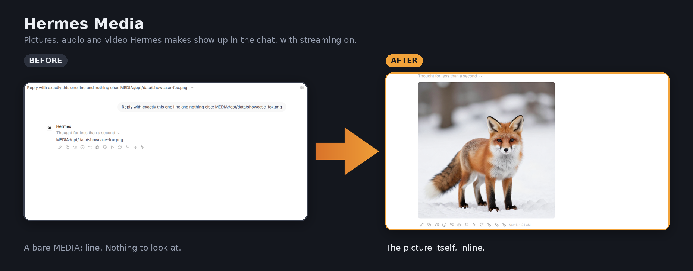
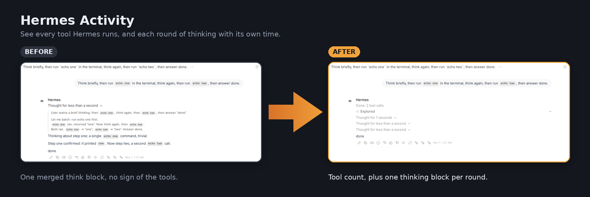
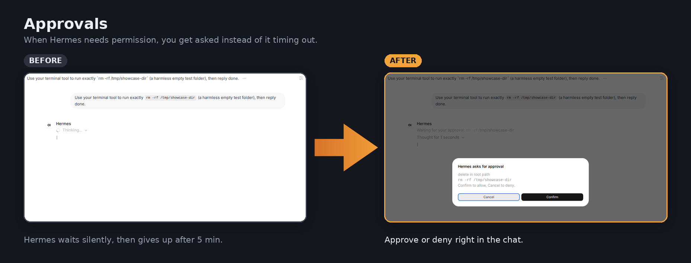
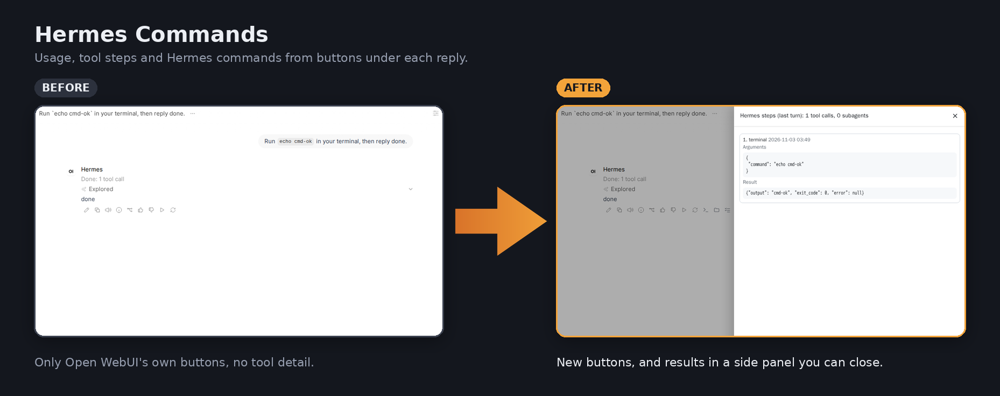

<div align="center">

# 🔌 openwebui-hermes-plugs

**Use [Hermes Agent](https://github.com/NousResearch/hermes-agent) from [Open WebUI](https://github.com/open-webui/open-webui) without losing the good parts.**

Pictures, tool activity, approvals, the Stop button and Hermes commands, in four small plugins.<br>
No extra backend. Nothing to host. Paste them into Open WebUI and go.


[What you get](#what-you-get) · [Quick start](#quick-start) · [The plugins](#the-plugins) · [One profile per user](#one-hermes-profile-per-open-webui-user) · [Locking it down](#locking-down-a-home-users-profile)

</div>

---

## What you get

### 🖼️ Pictures, audio and video show up in the chat
Hermes marks the files it makes as `MEDIA:` lines. Open WebUI can't reach the Hermes server's files, so all you
got was the text. **Hermes Media** fetches each file and swaps in the picture, a player or a download link. It also
passes files you attach on to Hermes, so it can open and edit the originals.



### 🛠️ You can see what Hermes is doing
**Hermes Activity** shows each tool call as a status line while Hermes works, and gives every round of thinking
its own block and time instead of one giant merged one.



### ✅ Approvals actually reach you
When Hermes wants permission for a risky command, Open WebUI used to say nothing until Hermes gave up.
Now you get an **Approve / Deny** dialog right in the chat.



### ⌨️ Hermes commands, one click away
**Hermes Commands** adds buttons under each reply: token usage, every tool step with its arguments and result,
your files, and a command box for scheduled tasks, memory, skills, sessions and steering a running turn. Results
open in a side panel you can scroll and close.



### ⏹️ And Stop means stop
**Hermes Stop** makes Open WebUI's Stop button stop Hermes too, not just the text on screen.

---

## Quick start

1. In Open WebUI, go to **Admin Panel › Functions › +** and paste a plugin file. Save, then switch it on.
2. Go to **Workspace › Models**, edit your Hermes model, and tick the plugin (filters under *Filters*,
   Hermes Commands under *Actions*).
3. Chat. Hermes Activity, Stop and Commands reuse the model's existing Hermes connection, so they need no
   settings. Hermes Media needs the dashboard address and a sign-in token ([setup below](#install)).

Each plugin works on its own; install any of them.

## The plugins

| Plugin | File | Type | What it does |
| --- | --- | --- | --- |
| [Hermes Media](#hermes-media) | `hermes_media.py` | Filter | Shows pictures, audio, video and files Hermes makes, with streaming on; passes your attachments to Hermes |
| [Hermes Activity](#hermes-activity-tool-calls-and-approvals) | `hermes_activity.py` | Filter | Tool status lines, per-round thinking, Approve/Deny dialogs, scheduled-task alerts |
| [Hermes Stop](#hermes-stop) | `hermes_stop.py` | Filter | Stop button stops the Hermes run, not just the reply on screen |
| [Hermes Commands](#hermes-commands) | `hermes_commands.py` | Action | Usage, tool steps (with subagents), My files and a Hermes command box, in a side panel |

They need no backend of their own: they talk to the Hermes API server and dashboard you already run, and they
follow each model's Open WebUI connection, so one set of plugins serves any number of Hermes profiles. See
[One Hermes profile per user](#one-hermes-profile-per-open-webui-user) for giving each person their own profile.

---

## Hermes Media

Hermes marks files in its replies as `MEDIA:/path/to/file`, or links them as `file:///path` or `workspace://path`. Open WebUI can't read files on the Hermes server, so those lines show up as plain text. This filter fetches each file from the Hermes dashboard when the reply finishes and swaps the line for the picture or a player. Open WebUI and Hermes can run on different machines.

### What you need

- Open WebUI 0.12 or newer, and an admin account on it.
- A Hermes Agent dashboard with username and password login turned on.
- Network access from the Open WebUI server to the dashboard port (9119 by default).
- Python 3 on any computer that can reach the dashboard (for the one-time sign-in).

### Install

#### 1. Give the Hermes dashboard a fixed signing secret

Without one, Hermes makes a new secret each time it starts, and the filter is logged out after every restart.

Generate a secret:

```bash
openssl rand -base64 32
```

Add it to the Hermes container's environment, next to the dashboard username and password, then recreate the container:

```yaml
environment:
  HERMES_DASHBOARD_BASIC_AUTH_USERNAME: <dashboard username>
  HERMES_DASHBOARD_BASIC_AUTH_PASSWORD: <dashboard password>
  HERMES_DASHBOARD_BASIC_AUTH_SECRET: <the secret you generated>
```

Keep the secret private. Changing it later signs out the filter and Hermes Desktop.

#### 2. Get a refresh token

Run this from any computer that can reach the dashboard:

```bash
python3 get_refresh_token.py http://<hermes-host>:9119
```

Enter the dashboard username and password when asked. The script prints a long token; copy it. Your password is only sent to the dashboard and is never saved.

#### 3. Add the filter to Open WebUI

1. Go to **Admin Panel › Functions** and click **+** (New Function).
2. Delete the sample code, paste the whole contents of `hermes_media.py`, and click **Save**.
3. **Turn the Hermes Media function on with its switch.** A function that is saved but switched off does nothing.

#### 4. Fill in the filter settings

Click the gear icon next to **Hermes Media** and set:

| Setting | Value |
| --- | --- |
| Dashboard URL | `http://<hermes-host>:9119` |
| Refresh Token | The token from step 2 |

Leave everything else at its default. Click **Save**.

#### 5. Attach the filter to your Hermes model

1. Go to **Workspace › Models** and edit the Hermes model.
2. Under **Filters**, tick **Hermes Media**, then save the model.

Attach it only to Hermes models. Don't make it global.

#### 6. Allow the audio and video players

Audio and video play in a small embedded player, which needs one Open WebUI setting turned on. Pick one:

- **For everyone (admin):** Admin Panel › Settings › General, user interface defaults: turn on **iframe Sandbox Allow Same Origin**.
- **For one person:** that person opens Settings › Interface and turns on **iframe Sandbox Allow Same Origin**.

To skip this step, turn off **Inline Players** in the filter settings. Audio and video then appear as attached files the user clicks to play.

#### 7. Turn streaming back on

If you turned streaming off to work around missing images, turn it back on for the Hermes model.

#### 8. Test it

Ask Hermes for a picture and a short sound clip. While the reply streams you may see a `MEDIA:` line for a moment; when it finishes, the picture and the player appear.

### Optional: tell the agent

Hermes may tell users that audio can't be shown in chat. Add a line like this to the Hermes profile's instructions:

> In Open WebUI, images, audio and video sent as `MEDIA:` tags are shown inline to the user.

### Optional: pictures straight from ComfyUI (no terminal needed)

A Hermes profile without the terminal tool can't download a ComfyUI result to show it. Let the filter fetch it
instead:

1. Set **Allowed Web Addresses** to your ComfyUI view address, for example `http://<comfyui-host>:8188/view?`.
2. Tell the agent (profile instructions or skill) to show results as
   `MEDIA:http://<comfyui-host>:8188/view?filename=<file name>&type=output` on their own line
   (add `&subfolder=<folder>` for files in a subfolder, such as songs).

Open WebUI must be able to reach that address. Only addresses that start with a listed prefix are fetched, and
redirects are refused.

### Settings

| Setting | Default | What it does |
| --- | --- | --- |
| Dashboard URL | (empty) | Where the Hermes dashboard is. Change this if Hermes moves. |
| Refresh Token | (empty) | Dashboard sign-in. The filter renews it on its own. |
| Allowed Folders | `/opt/data/` | Only files under these folders are fetched. Comma-separated. |
| Only This Profile's Files | On | A model wired to `/p/<profile>/v1` only gets files from that profile's folder (`/opt/data/profiles/<profile>/`); the default profile never gets other profiles' files. Turn off only if every profile belongs to the same person. |
| Send Attachments To Hermes | On | Copies files the user attaches into the profile's folder and tells Hermes where they are, so it can open and edit the originals. Open WebUI still adds the extracted text as before. Needs the dashboard settings above. |
| Attachments Folder | `uploads` | Folder inside the profile's folder that attachments are copied to. |
| Text Types From Outputs | `md,txt,csv,tsv,json,html,xml,ics` | Text files Hermes points to become download links too, but only from the profile's own `outputs/` and attachments folders, so memory notes, configs and logs stay out of chat. Needs Only This Profile's Files on. |
| Allowed Web Addresses | (empty) | Address starts the filter may fetch `MEDIA:` web links from, for example a ComfyUI `/view?` address. Empty: web links stay as text. |
| Image Types | `png,jpg,jpeg,gif,webp,bmp` | Shown as pictures. |
| Audio Types | `mp3,wav,ogg,m4a,flac,opus` | Shown as audio players. |
| Video Types | `mp4,webm,mov` | Shown as video players. |
| Download Types | `pdf,docx,xlsx,pptx,zip` | Attached as download links. Text types (`md`, `txt`, `json`, `csv`) are left out on purpose: Hermes's memory notes, configs and logs are text files, and a reply could otherwise pull them into the chat. |
| Workspace Folder | (empty) | Base folder for `workspace://` links. Empty asks the dashboard. |
| Max File Size (MB) | 100 | Larger files are skipped. |
| Download Timeout (s) | 60 | Per file. |
| Inline Players | On | Off attaches audio and video as files instead. |

### Troubleshooting

When a file can't be shown, the `MEDIA:` line stays in the reply with a short note after it.

| Note | Fix |
| --- | --- |
| `(media unavailable: filter not configured)` | Fill in Dashboard URL and Refresh Token (step 4). |
| `(media unavailable: dashboard login expired)` | Run step 2 again and paste the new token. Happens after the signing secret changes, or if the Hermes model isn't used for 30 days. |
| `(media unavailable: Hermes unreachable)` | Check Dashboard URL, that Hermes is running, and that the Open WebUI server can reach port 9119. |
| `(media unavailable: not found)` | The file isn't on the Hermes server at that path. |
| `(media unavailable: too large)` | Raise Max File Size, or ask Hermes for a smaller file. |
| Players show but stay at 0:00 | Step 6 isn't done for that user. |
| A `MEDIA:` line stays with no note | The path is outside Allowed Folders or outside this profile's folder, the web address isn't in Allowed Web Addresses, or the file type isn't in the type lists. This is on purpose. |

### Security notes

- The refresh token has full access to the Hermes dashboard. Treat it like the dashboard password.
- Only Open WebUI admins can see or change filter settings. Regular users never see the token.
- Turn on `ENABLE_VALVE_ENCRYPTION=true` in Open WebUI's environment so filter settings are encrypted in its database. The key comes from `WEBUI_SECRET_KEY`.
- Every Function and Tool installed in Open WebUI runs in the same process and could read the token. Only install ones you trust.
- The dashboard uses plain HTTP. Limit port 9119 to the Open WebUI server and admin machines with a firewall, or put HTTPS in front of it.
- The filter only fetches media types from Allowed Folders, so a reply can't pull other files from the Hermes server into a chat.
- Attachments are copied into the Hermes profile the model is wired to, under its own folder. Turn off **Send Attachments To Hermes** if files should stay in Open WebUI only.
- The dashboard token can read every profile's files. Keep **Only This Profile's Files** on when different people use different profiles, so one person's model can't show another person's files.

### Moving Hermes to another server

Change **Dashboard URL**. Run step 2 again only if the signing secret changed. If the new install stores data somewhere other than `/opt/data`, update **Allowed Folders**.

---

## Hermes Activity: tool calls and approvals

While Hermes works, Open WebUI normally shows nothing: no tools, no progress. When Hermes needs permission to run a command, it waits up to 5 minutes for an answer that Open WebUI never asks for, then gives up. This filter fixes both:

- Each tool Hermes starts shows as a status line under the reply, for example "💻 terminal: ls". Every step is saved with the message.
- When Hermes asks permission, a dialog pops up with the command. **Confirm** allows it, **Cancel** denies it, and Hermes carries on right away.

It needs no settings: it reuses the Hermes connection Open WebUI already has.

### Install

1. Go to **Admin Panel › Functions** and click **+** (New Function).
2. Delete the sample code, paste the whole contents of `hermes_activity.py`, and click **Save**.
3. **Turn the Hermes Activity function on with its switch.**
4. Go to **Workspace › Models**, edit the Hermes model, tick **Hermes Activity** under **Filters**, and save.
5. Test it: ask Hermes something that needs a tool, such as "list the files in your home folder". Status lines appear while it works.

Keep streaming on for the Hermes model; the filter only works on streamed replies.

### Settings

All optional.

| Setting | Default | What it does |
| --- | --- | --- |
| Show Tool Calls | On | Status line per tool. |
| Approval Dialogs | On | Off: no dialog; Hermes's request times out and counts as denied. |
| Approve Means | `once` | `once` allows just this command. `session` also allows the same kind of command for the rest of the chat. `always` allows that kind of command from now on. |
| Scheduled Task Alerts | On | When you send a message, a pop-up for each scheduled Hermes task that finished or failed since your last one. |
| Split Thinking | On | Each round of thinking between tool calls gets its own "Thought for N seconds" block. Off: Open WebUI's default, one block for the whole turn with the first round's time. |
| Approval Timeout (s) | 280 | Dialog closes after this long with no answer, which counts as denied. Hermes gives up at 300. |
| Hermes API URL, Hermes API Key | (empty) | Only if approvals fail to send: the Hermes connection URL (ending in `/v1`) and key. Empty uses the model's own connection. |

### Troubleshooting

| What you see | Fix |
| --- | --- |
| No status lines at all | Check the function is switched on and ticked on the model, and that streaming is on. |
| "Could not send your answer to Hermes (401)" | The model's connection key is wrong; set Hermes API URL and Key in the filter settings. |
| "Could not send your answer to Hermes (404)" or "(409)" | Hermes already gave up on that request (more than 5 minutes passed). Ask again. |
| Dialog never appears, status says "Waiting for your approval" | The browser tab was closed or reloaded during the wait. Ask again with the chat open. |

---

## Hermes Stop

Open WebUI's **Stop** button ends the reply on screen, but Hermes can keep working in the background, still running tools and using the model. Sending a new message while a reply is still streaming does the same, because Open WebUI stops the current reply first.

This filter notices when a Hermes reply ends early and tells Hermes to stop that run, through Hermes's own stop endpoint. You keep using the normal Stop button. It needs no settings: it reuses the Hermes connection Open WebUI already has.

### Install

1. Go to **Admin Panel › Functions** and click **+** (New Function).
2. Delete the sample code, paste the whole contents of `hermes_stop.py`, and click **Save**.
3. **Turn the Hermes Stop function on with its switch.**
4. Go to **Workspace › Models**, edit the Hermes model, tick **Hermes Stop** under **Filters**, and save.
5. Test it: ask Hermes for something slow, press **Stop**, and check Hermes's log for `Turn ended: reason=interrupted`.

Keep streaming on for the Hermes model; the filter only works on streamed replies.

### Settings

| Setting | Default | What it does |
| --- | --- | --- |
| Hermes API URL, Hermes API Key | (empty) | Only if stopping fails: the Hermes connection URL (ending in `/v1`) and key. Empty uses the model's own connection. |

### Good to know

- A reply that finishes normally is never stopped.
- If stopping fails, Open WebUI's log shows `Hermes Stop: could not stop <run id>` or `Hermes Stop: stop <run id> -> <status>`.

---

## Hermes Commands

Adds three buttons under every Hermes reply (hover the reply to see them):

- **Hermes usage**: tokens, cost, model calls, tool calls and messages for this chat.
- **Hermes steps**: every tool Hermes used in the last turn, with its arguments and result, plus a card per subagent showing what it did.
- **Hermes command**: opens a box where you type a command. Results are not sent to Hermes.

There is also a **My files** button. Results open in a side panel straight away; it scrolls and closes with X, Esc or a click outside. Set **Show Results In** to `chip` for a source chip under the reply, or `inline` for a card at the top of the reply.

| Command | What it does |
| --- | --- |
| `help` | List of commands |
| `usage`, `steps [all]`, `last` | Usage, tool steps, Hermes's latest reply in full (for when a reply was cut off) |
| `steer <text>` | Add guidance to the turn Hermes is running now (click the button on an earlier reply while it works) |
| `stop` | Stop the turn Hermes is running now |
| `title <text>`, `model [name]` | Rename the chat (in Hermes and Open WebUI), list or switch models |
| `todos` | Hermes's task list for this chat |
| `cron`, `cron add <schedule> \| <prompt>`, `cron pause\|resume\|run\|delete\|runs <id>`, `cron edit <id> name\|schedule\|prompt <value>` | Scheduled tasks |
| `skills [search]`, `skill <name>`, `skill enable\|disable <name>` | Skills |
| `memory`, `memory add <text>` | Hermes's memory files |
| `insights [days]` | Tokens and cost per day, by model, top skills |
| `files [path]`, `file <path>`, `workspaces` | Browse the Hermes server's files (with git status); open text, images, audio, video; other files come as downloads |
| `sessions [search]`, `import <id>` | Hermes sessions from every surface (CLI, Telegram, Desktop...), copy one into a new chat |
| `browse [path]` | This profile's folders in the side panel: click a folder to open it, **Up** or the path at the top to go back, a file to download it. Hidden (dot) files are left out |
| `myfiles` (also its own **My files** button) | Files Hermes made for you (`outputs/`) and files you attached (`uploads/`), newest first, as downloads |
| `status` | Hermes version, profile, model, toolsets, scheduled tasks |
| `forget` | Delete this chat's Hermes session (asks first). Open WebUI's own delete leaves the Hermes session behind. |

### Install

1. Go to **Admin Panel › Functions** and click **+** (New Function).
2. Delete the sample code, paste the whole contents of `hermes_commands.py`, and click **Save**.
3. **Turn the Hermes Commands function on with its switch.**
4. Go to **Workspace › Models**, edit the Hermes model, tick **Hermes Commands** under **Actions**, and save.
5. Test it: after any Hermes reply, hover it and click **Hermes usage**.

`steer` and `stop` need the Hermes Stop filter, which tracks the running turn. `skills`, `skill`, `memory`, `insights`, `files`, `file`, `workspaces` and `cron runs` need the Hermes dashboard: they use Hermes Media's Dashboard URL and Refresh Token, or the same two settings here.

### Settings

All optional.

| Setting | Default | What it does |
| --- | --- | --- |
| Hermes API URL, Hermes API Key | (empty) | Empty uses the model's own connection. |
| Dashboard URL, Dashboard Refresh Token | (empty) | Empty uses Hermes Media's. |
| Hermes Profile | (empty) | Empty reads it from the connection URL (`/p/<profile>/v1`), else `default`. |
| Browsable Folders | (empty) | Folders `files`, `file` and `memory` may read. Empty = this profile's own folder only; other profiles' folders are always hidden unless listed here. |
| Show Results In | `panel` | `panel`: a side panel that opens at once, scrolls, and closes with X, Esc or a click outside. `chip`: a source chip under the reply. `inline`: a card at the top of the reply. |
| My Files: Max File Size (MB) | 200 | Larger files are listed without a download link, and `browse` will not download them. |
| Sidebar Files: Profile per User | (empty) | `user=profile` pairs, comma-separated (for example `alice=default, bob=work`), matched by Open WebUI username, email or name. The sidebar Files entry then shows each person their own Hermes profile's files, whichever Hermes model it borrows. Empty = the profile of that model's connection. |

### Optional: a Files entry in the sidebar

`web/loader.js` adds a **Files** entry under Notes in Open WebUI's sidebar. It opens a folder browser in the side panel (the `browse` command), starting at the profile's own folder. It only appears for people who have a model with Hermes Commands attached, and it uses their own Open WebUI login. It borrows the first such model it finds, so if several people share one Open WebUI, set **Sidebar Files: Profile per User** so nobody browses someone else's profile.

Open WebUI runs `/static/loader.js` on every page and copies it from `/app/build/static/` when the container starts. Mount the file there (read-only), then recreate the container:

```yaml
services:
  open-webui:
    volumes:
      - /path/to/openwebui-hermes-plugs/web/loader.js:/app/build/static/loader.js:ro
```

Changes to `loader.js` take effect on the next container start. The sidebar layout is not a stable Open WebUI interface; if an update moves things, the entry simply does not appear and nothing else changes.

`web/panel.js` is the side panel on its own; the plugin already carries a copy, so you don't install it separately.

### Good to know

- Typing `/usage` into the normal chat box sends it to the model as text; Open WebUI cannot run commands from the chat box without the model. Use the Hermes command button.
- Commands act on this chat's own Hermes session, found from its first message.
- Hermes refuses sensitive files (`.env`, `config.yaml`, tokens), whatever the path.


---

## One Hermes profile per Open WebUI user

Each person logs in to Open WebUI with their own account and sees one model. That model is wired to one Hermes
profile, so their chats, memory and skills stay in that profile. The plugins follow the model's connection, so
they always talk to the right profile with no per-profile settings.

```
Open WebUI login  ──group access──▶  model "kids"  ──connection──▶  http://<hermes-host>:8642/p/kids/v1
Open WebUI login  ──group access──▶  model "work"  ──connection──▶  http://<hermes-host>:8642/p/work/v1
```

1. **Hermes:** turn on profile routing in the gateway (`multiplex_profiles: true`) and the API server (default
   port 8642). Each profile answers at `http://<hermes-host>:8642/p/<profile>/v1`; the default profile at
   `http://<hermes-host>:8642/v1`. Give each profile its own `API_SERVER_KEY` in its `.env`: a profile's key then
   only opens that profile's address.
2. **Open WebUI connection:** Admin Panel › Settings › Connections › OpenAI API › **+**. URL: the profile's
   address. Key: that profile's API key. A model named after the profile appears.
3. **Who sees it:** give each person an account and a group; on Workspace › Models set the profile's model to
   **Private** with access for that group. Make every other model Private too.
4. **Plugins:** on the model, tick Hermes Media, Hermes Activity and Hermes Stop under Filters and Hermes
   Commands under Actions.

Create new profiles without `--clone` (`hermes profile create <name>`): cloning copies the source profile's
memory into the new one.

---

## Locking down a home user's profile

Hermes keeps each profile's memory, chats, skills and scheduled tasks separate, but it does **not** keep a
profile's tools out of other profiles' files: the terminal, file and code tools can read and change anything in
the Hermes data folder, including other profiles' folders and `.env` files. For a profile used by someone else,
choose the tools it gets on the API route in that profile's `config.yaml`:

```yaml
platform_toolsets:
  api_server: [web, skills, todo, memory, session_search, <your MCP servers>]
  cron:       [web, skills, todo, memory, session_search, <your MCP servers>]
```

| Left out | Why |
| --- | --- |
| `terminal`, `code_execution`, `file` | Can read and change every profile's files |
| `vision` | Can read any picture on the Hermes server by path (pictures the user uploads still reach the model) |
| `browser` | Can reach internal web pages |
| `cronjob` | A scheduled job can set its own tool list or run a script, which brings the terminal back. Scheduling still works through the Hermes Commands `cron` command, and those jobs run with the `cron` list above. |
| `connections`, `delegation` | Rarely needed; subagents can only inherit the parent's tools anyway |

Without the `file` tool the agent can't open attachments or save files, so show generated pictures through
[Allowed Web Addresses](#optional-pictures-straight-from-comfyui-no-terminal-needed), and point any MCP server's
working folders (for example a ComfyUI workflow folder) at a copy inside the profile's own folder. The change
takes effect on the next request.

---

## Locking down Open WebUI for home users

| Setting | Recommended | Why |
| --- | --- | --- |
| `ENABLE_RAG_LOCAL_WEB_FETCH` | `False` | Otherwise a pasted internal address (for example a ComfyUI or router page) is fetched from inside your network |
| `ENABLE_RAW_DOCS_SSRF_PROTECTION` | `true` | Same reason, for document links |
| `ENABLE_VALVE_ENCRYPTION` | `true` | Encrypts plugin settings (keys, tokens) in Open WebUI's database |
| Community Sharing | Off | Users could publish chats, pictures included, to openwebui.com |
| Direct Connections | Off | Users could add their own model endpoints |
| User permissions: workspace tools/functions | Off (default) | Tools and functions run code on the Open WebUI server |
| iframe Sandbox Allow Same Origin | Only if you want inline audio/video players | With it on, HTML in a reply (artifacts, HTML cards) runs as Open WebUI and can act as that user's account. Off: turn off Hermes Media's **Inline Players**; audio and video then arrive as file chips. |

---

## Tests

```bash
# unit tests (needs Python with pydantic and aiohttp, e.g. inside the Open WebUI image)
python3 -m unittest discover -s tests
```

---

## License

MIT. See [LICENSE](LICENSE). A side project, shared as-is.
